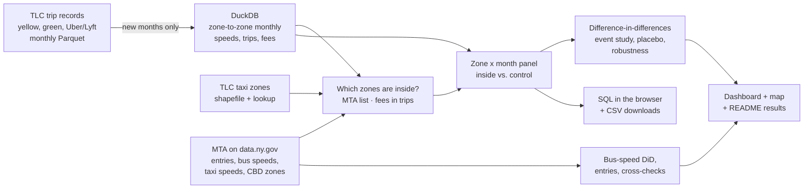

# NYC Congestion Pricing Impact: Causal Analysis of the Manhattan Toll

[](https://github.com/dvskaff/congestion-pricing-impact/actions/workflows/ci.yml)
[](https://github.com/dvskaff/congestion-pricing-impact/actions/workflows/pipeline.yml)
 


* **Dashboard:** [results, charts and a map of every taxi zone](https://dvskaff.github.io/congestion-pricing-impact/)
* **Map:** [speed and trip changes by zone (click a zone for its history)](https://dvskaff.github.io/congestion-pricing-impact/#map)
* **SQL:** [query the data in your browser, or download it](https://dvskaff.github.io/congestion-pricing-impact/sql.html)

On January 5, 2025, New York became the first U.S. city to charge drivers for entering a downtown zone: Manhattan
south of 60th Street. **Did it actually make traffic faster, and by how much once seasons and citywide trends are
taken out?** This project answers that with public data only:

* **Every taxi and ride-hail trip since 2023** (NYC TLC trip records: yellow and green taxis, Uber, Lyft and other
  app rides), condensed with DuckDB into zone-to-zone monthly speeds and trip counts.
* **A causal design:** difference-in-differences comparing taxi zones inside the toll zone with zones in Manhattan
  above 60th Street, with zone and month fixed effects and standard errors clustered by zone: the effect in each toll
  year vs. 2024, a month-by-month event study, a pre-toll trend test with a placebo year, a trend-adjusted estimate for
  when the two areas were not moving in parallel, and alternative controls and specifications.
* **Independent checks:** MTA bus speeds inside vs. outside the zone (the same design on a different source), the
  MTA's own taxi speed estimates, MTA counts of vehicles entering the zone, and the per-trip congestion fee recorded
  on every taxi and app ride, which also confirms which taxi zones are inside the toll zone.

## Results

Rewritten automatically after every run.

<!-- RESULTS:START -->
_TLC trip records Jan 2023 to Sep 2026 · 1,028M taxi and ride-hail trips · 38 taxi zones inside the toll zone (per-trip congestion fees in the trip records) · last run 2026-11-09 00:50 UTC_

| Speed of taxi and app-ride trips inside the zone, weekday toll hours, vs. Manhattan above 60th St | Effect (95% CI) |
|---|---|
| **First toll year: 2025 vs. 2024** | **+2.4% (+1.8% to +3.0%)** |
| Second toll year: 2026 vs. 2024 | +0.3% (-0.6% to +1.2%) |
| **Trend-adjusted: if the pre-toll drift had continued** | **+10.0% (+9.1% to +10.9%)** |
| Placebo, before any toll: 2023 vs. 2024 (should be about zero) | +2.4% (+2.0% to +2.9%) |
| Pooled: all toll months vs. all earlier months (assumes parallel trends) | +0.3% (-0.4% to +1.0%) |
| Robustness: Control: Brooklyn, Queens and the Bronx, 2025 vs. 2024 | +2.0% (+1.6% to +2.4%) |
| Robustness: Weighted by number of trips, 2025 vs. 2024 | +2.4% (+1.8% to +3.1%) |
| Robustness: Weekend toll hours, 2025 vs. 2024 | +4.0% (+3.3% to +4.6%) |
| Robustness: Overnight (lower toll), 2025 vs. 2024 | +1.9% (+1.4% to +2.5%) |
| Robustness: Yellow taxis only, 2025 vs. 2024 | +0.4% (-1.0% to +1.8%) |
| Robustness: Uber, Lyft and other app rides only, 2025 vs. 2024 | +2.8% (+2.2% to +3.4%) |
| Taxi and app-ride pickups: first toll year: 2025 vs. 2024 | -1.9% (-3.0% to -0.7%) |
| Taxi and app-ride pickups: second toll year: 2026 vs. 2024 | -7.0% (-9.5% to -4.5%) |
| MTA bus speeds inside vs. outside the zone: First toll year: 2025 vs. 2024 | +2.9% (+2.2% to +3.6%) |
| MTA bus speeds inside vs. outside the zone: Trend-adjusted: if the pre-toll drift had continued | +5.9% (+5.2% to +6.7%) |

**Before the toll,** inside-zone speeds drifted -4.4% a year relative to the control zones (p < 0.001), so the year-over-year and trend-adjusted estimates bracket the toll's effect; see the dashboard for the month-by-month picture.

**Trips, latest 12 toll months vs. a year earlier:** within the zone -3.0% · into the zone -0.9% · out of the zone -0.3% · outside the zone +8.2%

**Vehicles entering the zone (MTA):** 482,249 per weekday in 2026, -4.0% vs. the same days of 2025 (Jan 5 to Oct 31).
<!-- RESULTS:END -->

## Explore it yourself

* **Map.** The [dashboard's map](https://dvskaff.github.io/congestion-pricing-impact/#map) colors all 263 taxi zones
  by the change in speed, the change in pickups, or the share of trips charged the fee; click any zone for its monthly
  speed and pickups next to the control zones.
* **SQL in the browser.** The [SQL page](https://dvskaff.github.io/congestion-pricing-impact/sql.html) loads every
  table behind the analysis (zone speeds, trips by relation to the zone, fees, the estimates, MTA vehicle entries and
  bus speeds) into DuckDB running in your browser, with example queries. Every table can also be downloaded as CSV.

## How it works



<details><summary>Every step in detail</summary>

```
TLC trip records (CloudFront, monthly Parquet: up to ~20M Uber/Lyft rides a month)
   │  src/congestion/tlc.py      download one file, condense with DuckDB, delete; only new months on later runs
   │                             od (zone x zone x toll period: trips, fees, miles, hours) · zoneday · hourly
   ▼
src/congestion/zones.py          TLC zone lookup + shapefile (State Plane → lon/lat) · zones inside the toll zone:
                                 MTA list (yfdc-w5jh), same-zone trips charged the fee, fixed fallback; agreement shown
src/congestion/mta.py            data.ny.gov SoQL aggregates: vehicle entries (t6yz-b64h), bus speeds (r6db-kkzj),
                                 MTA taxi speeds (6p29-6xqn); field names discovered, each dataset optional
   ▼
src/congestion/analysis.py       zone x month panel (speed of trips from the zone to the same area, weekday toll hours)
                                 TWFE difference-in-differences (statsmodels, clustered by zone): each year vs. 2024 ·
                                 placebo 2023 · pre-trend slope · trend-adjusted · event study · other control ·
                                 weighted · by period/service
   ▼
dashboard + map (GitHub Pages) · sql.html (DuckDB-WASM) · README results  ← GitHub Actions, weekly
```

</details>

### Method notes

* **Outcome.** For each taxi zone and month: total miles over total hours of taxi and ride-hail trips that start in the
  zone and end in the same area, during weekday toll hours (5 a.m. to 9 p.m.). Trips must last 1 minute to 3 hours,
  cover 0.1 to 100 miles and average 0.5 to 75 mph.
* **Treated and control.** Zones inside the toll zone vs. zones in Manhattan above 60th Street (dense, similar street
  grid, same weather and seasons, no toll). Brooklyn, Queens and the Bronx serve as an alternative control. Airports,
  parks and islands are left out.
* **Estimate.** `log(speed) = Σ b_year · inside · year + zone effect + month effect`, with 2024 (the last year before
  the toll) as the reference and standard errors clustered by zone; `exp(b_2025) - 1` is the first toll year's effect
  if, without the toll, the gap between inside and control zones would have stayed at its 2024 level. The 2023
  coefficient is a placebo (no toll yet, so it should be about zero), and the event study and pre-toll trend slope
  check the same assumption month by month.
* **When trends are not parallel.** Before the toll, inside-zone speeds were drifting down relative to the control
  zones, so the year-over-year estimate is a lower bound if that drift would have continued. A second model adds a
  separate linear time trend for inside zones and measures the toll as a jump away from that trend at January 2025
  (the trend's slope is estimated from the months before and after the toll together). The two estimates bracket the
  effect, and the dashboard shows both.
* **Limits.** Taxis and app rides are a sample of traffic, not all of it. Control zones could be indirectly affected
  (traffic diverting around the zone), which would bias the estimate. January 2025 includes four days before the
  toll. MTA entry counts only exist since the toll started, so they show the trend since, not the initial drop.

## Repository layout

```
src/congestion/   config · source (HTTP) · tlc (trip records → aggregates) · zones · mta · analysis
                  report (+ report_base) · explore (SQL page + downloads) · readme · pipeline
                  fixture.py: SYNTHETIC data with planted effects for tests (pages built from it say so)
scripts/          fetch_web_runtime.sh: DuckDB-WASM from npm for the SQL page
tests/            aggregation on every file layout, toll periods, polygons, zone definition, MTA field discovery,
                  end-to-end run that must recover the planted effects (and find nothing in the placebo year)
.github/          ci.yml (lint + tests) · pipeline.yml (weekly real-data run → GitHub Pages)
```

## Run it

Everything runs in GitHub Actions (**Actions → Analysis → Run workflow**). Locally:

```bash
pip install -r requirements-dev.txt
pytest -q                                              # synthetic data, about a minute
PYTHONPATH=src python -m congestion.pipeline --fixture # the whole pipeline on synthetic data
PYTHONPATH=src python -m congestion.pipeline           # real data (first run downloads ~25 GB of trip files)
```

Data: [NYC TLC Trip Record Data](https://www.nyc.gov/site/tlc/about/tlc-trip-record-data.page) (public) ·
MTA datasets on [data.ny.gov](https://data.ny.gov) (public). Code: MIT license.
